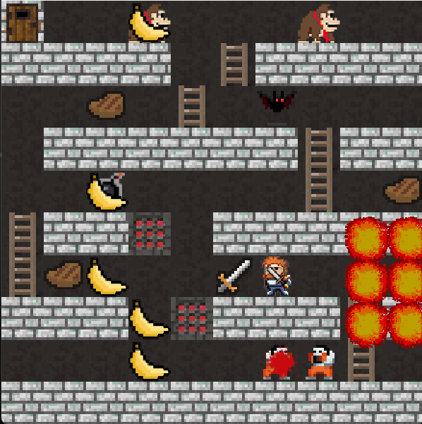

# Donkey Kong 2D

<p align="center">
  
</p>

<p align="center">
  <a href="https://github.com/MD2SA/DonkeyKong/actions/workflows/build.yml">
    
  </a>
  
  
</p>

A 2D platform game inspired by the classic **Donkey Kong**, built with **Java Swing**. Guide Manel through four handcrafted levels, dodge enemies and traps, collect items and rescue the princess.

The project started as the final assignment for the **Object-Oriented Programming (OOP/POO)** course at **ISCTE-IUL** and is now maintained as a public portfolio project.

## Features

- Four bundled levels and support for custom room files
- Player movement with gravity, ladders and platform collision
- Enemies and projectiles: Donkey Kong, BadGuy, Bat, bananas and fireballs
- Inventory and items: bombs, sword, key and meat
- Traps, hidden traps, locked doors and a rescue objective
- Animations for explosions, fire and damage
- Persistent local top-10 scores for each room set
- Object-oriented architecture with the Observer pattern and a position-based entity map

## Controls

| Key | Action |
| --- | --- |
| Arrow keys | Move and climb |
| B | Place a bomb |

## Requirements

- **Java 21 or newer** — the code uses the Sequenced Collection API
- Linux, macOS or Windows
- No runtime dependencies
- The Maven wrapper is included, so Maven does not need to be installed

## Getting started

### 1. Clone the repository

```bash
git clone https://github.com/MD2SA/DonkeyKong.git
cd DonkeyKong
```

### 2. Run the game

**Linux / macOS**

```bash
./mvnw compile exec:java
```

**Windows (PowerShell or CMD)**

```powershell
.\mvnw.cmd compile exec:java
```

The Maven wrapper compiles the project into `target/classes` and starts `pt.iscte.poo.game.Main`.

### Build a jar

```bash
./mvnw package
java -jar target/donkey-kong-1.0.0.jar
```

Run the jar from the repository root so the game can find `images/` and `rooms/`.

### Run with custom rooms

```bash
./mvnw compile exec:java -Dexec.args="rooms/custom"
```

```powershell
.\mvnw.cmd compile exec:java "-Dexec.args=rooms/custom"
```

If no path is given, the game loads the levels in `rooms/default/`.

<details>
<summary>Room file format</summary>

Room files are plain-text 10×10 grids. Intermediate levels start with a `#<level>;<next-file>` header; the final level omits the header so the game ends after it. Each character maps to an element:

| Character | Element |
| --- | --- |
| ` ` | Floor |
| `W` | Wall |
| `S` | Stairs |
| `t` | Trap |
| `h` | Hidden trap |
| `G` | Donkey Kong |
| `B` | Bat |
| `g` | BadGuy |
| `b` | Bomb |
| `k` | Key |
| `s` | Sword |
| `m` | Meat |
| `0` | Door |
| `.` | Locked door |
| `P` | Princess |
| `H` | Player start |

See [`rooms/default/`](rooms/default/) and [`rooms/custom/`](rooms/custom/) for complete examples.

</details>


### Run from an IDE

- **Eclipse:** `File > Import > Existing Maven Projects`, select the repository and run `pt.iscte.poo.game.Main`.
- **IntelliJ IDEA:** open the repository (or its `pom.xml`), wait for Maven import and run `Main`.

## Project structure

```text
pom.xml                      Maven build configuration
mvnw / mvnw.cmd              Maven wrapper scripts
src/main/java/
├── objects/                 Game entities and world elements
│   ├── animations/          Explosions, blood and fire effects
│   ├── attackers/           Enemies and projectiles
│   ├── interfaces/          Gameplay contracts
│   ├── items/               Collectibles and inventory items
│   └── staticElements/      Floors, walls, stairs, doors and traps
└── pt/iscte/poo/
    ├── game/                Game loop, rooms, loading and entity management
    ├── gui/                 Swing GUI (course-provided base)
    ├── observer/            Observer pattern (course-provided base)
    └── utils/               Geometry, direction, time and file helpers
rooms/
├── default/                 Four bundled levels
└── custom/                  Example custom levels
images/                      Sprites, screenshots and UML diagram
```

## Architecture

`GameEngine` is a singleton that observes the GUI. Each tick advances the current `Room`; `RoomLoader` parses the text-based levels and `EntityManager` stores entities in a position map for fast lookups. Game elements implement `ImageTile`, so the GUI can render them by layer without knowing their concrete types.

Completed runs are stored locally in `scores/`, which is ignored by Git.

The UML diagram is available at [`images/UML.png`](images/UML.png).

## Roadmap

Planned improvements are tracked in [ROADMAP.md](ROADMAP.md). Contributions and suggestions are welcome — see [CONTRIBUTING.md](CONTRIBUTING.md).

## Credits

- The initial package structure and the base classes in `src/main/java/pt/iscte/poo/gui`, `observer` and `utils` were provided by the **Object-Oriented Programming course team at ISCTE-IUL (POO 2024)**. They are included for educational continuity and remain the work of their original authors.
- Gameplay, levels, entities, UI integration and documentation were developed by **MD2SA**.
- Sprite assets are used for educational, non-commercial purposes. *Donkey Kong* and related characters are trademarks of Nintendo. This is a fan-made project and is not affiliated with or endorsed by Nintendo.

## License

The original code in this repository is released under the [MIT License](LICENSE). Third-party course material and sprite assets are excluded from that grant and remain the property of their respective owners.
